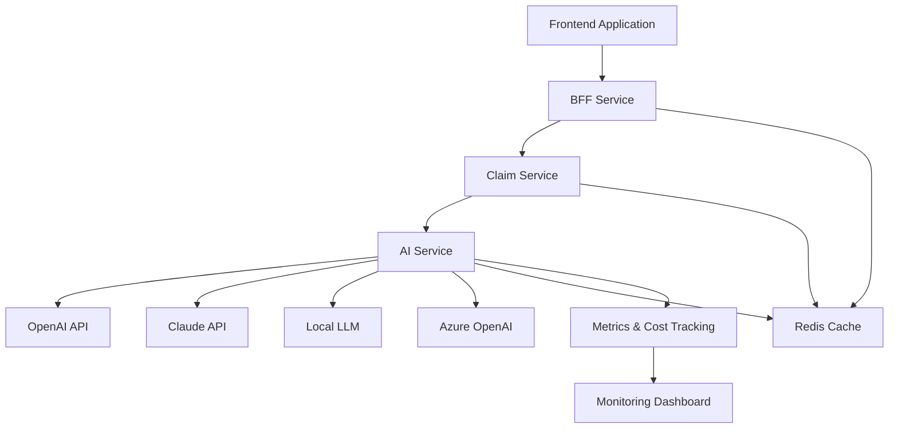
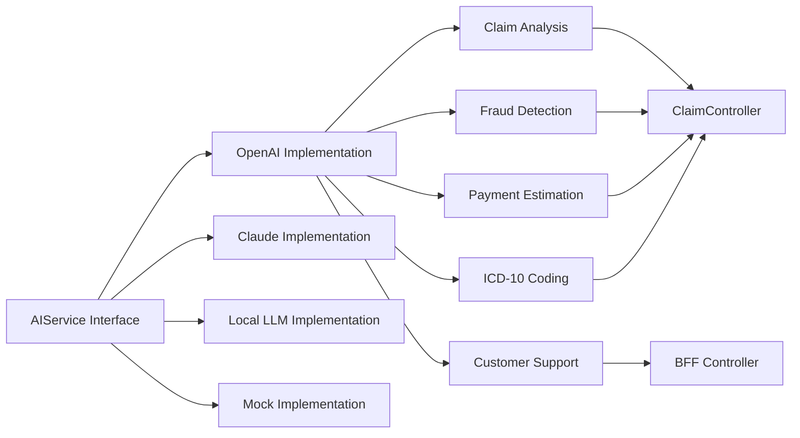
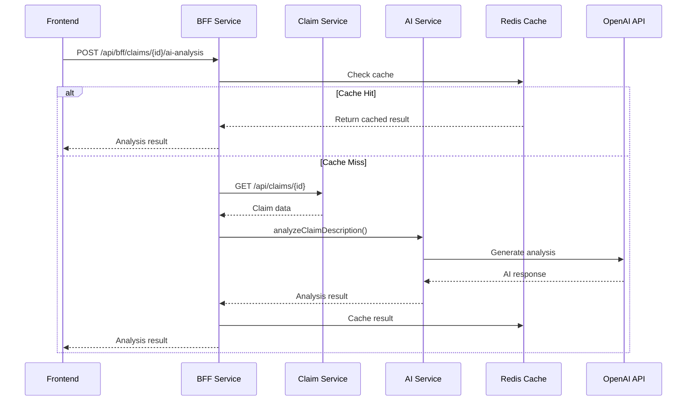
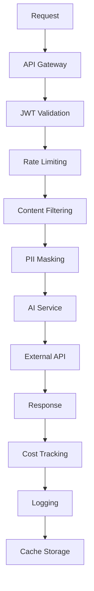
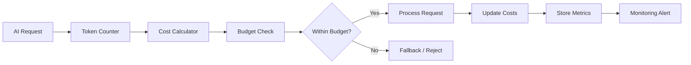
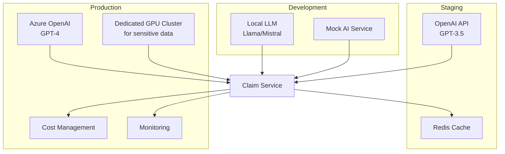
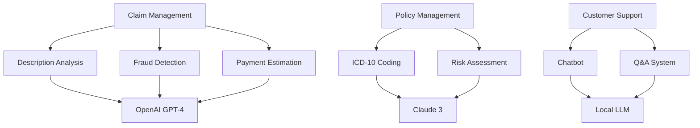
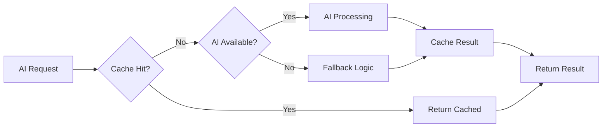
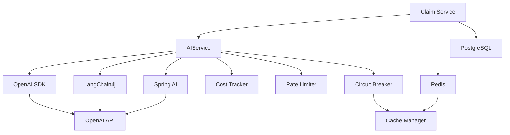
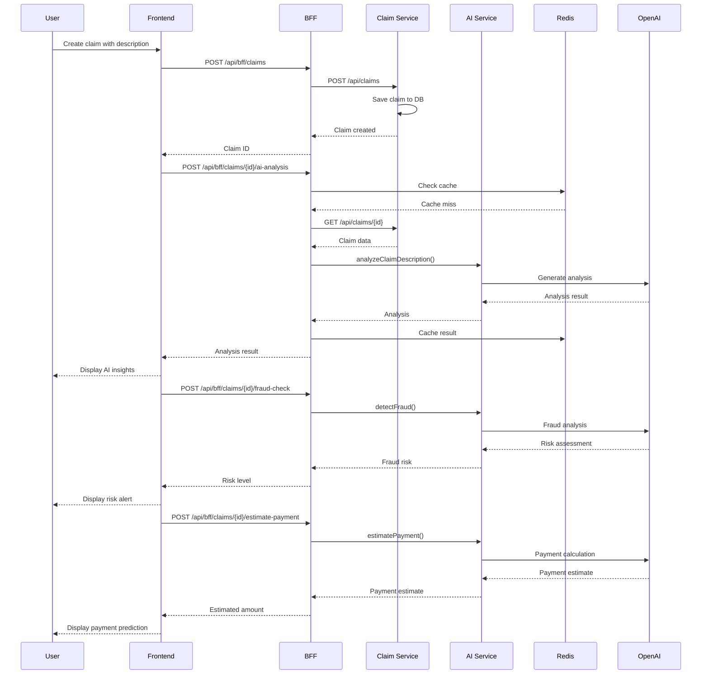

# 🤖 AI Integration Architecture Diagrams

## 🎯 AI Integration Flow

## 🔄 AI Service Components

## 📊 AI Request Flow

## 🔒 Security Layers

## 💰 Cost Management Flow

## 🚀 Deployment Architecture

## 🎯 AI Use Case Mapping

## 📊 Performance Optimization

## 🔧 Service Dependencies

## 🎯 Data Flow: Claim with AI

