# 🎨 Chatbot Architecture Diagrams

## 🎯 Overall Chatbot Architecture

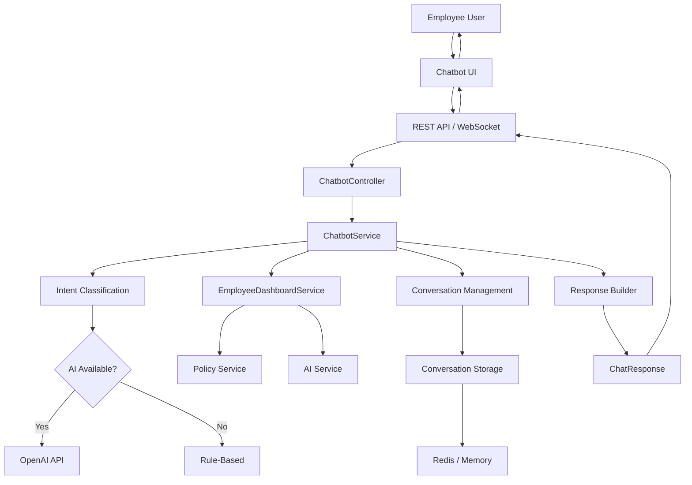

## 🔄 Chatbot Message Flow

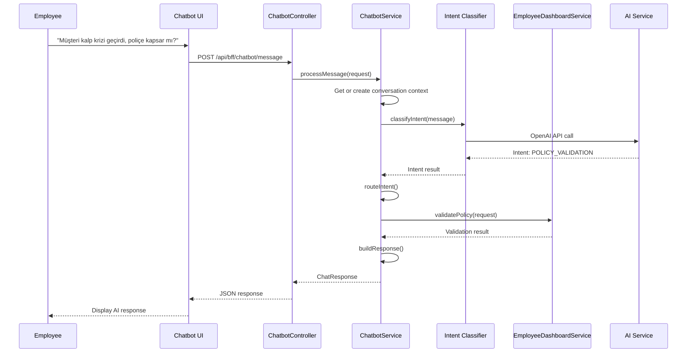

## 🎯 Intent Classification Flow

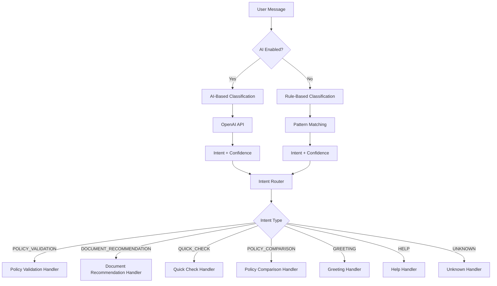

## 📊 Conversation State Management

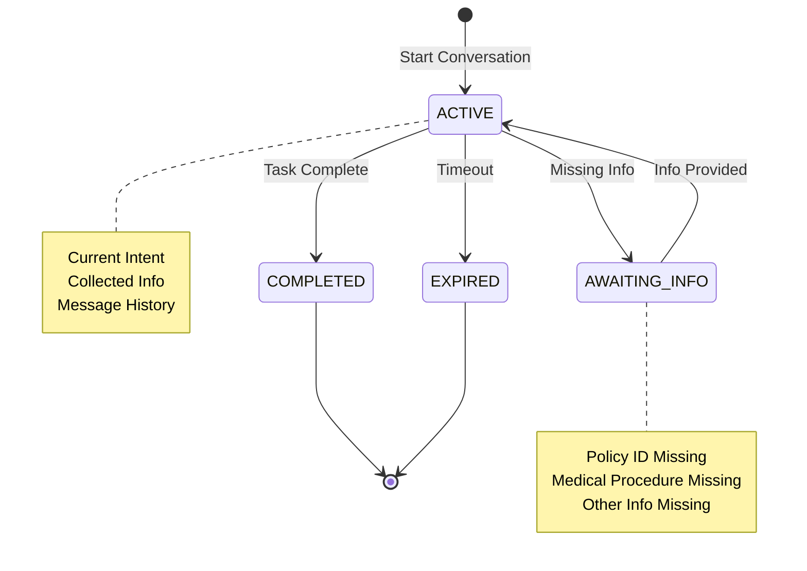

## 🎨 Chatbot UI Components

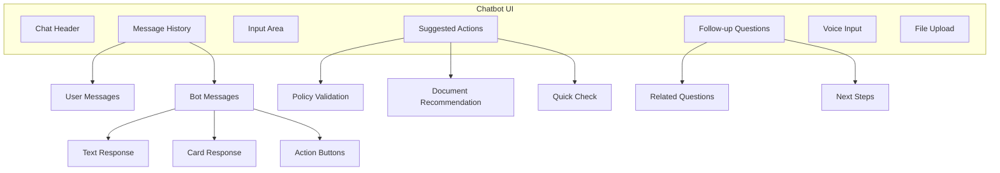

## 🔄 Multi-Step Conversation Flow

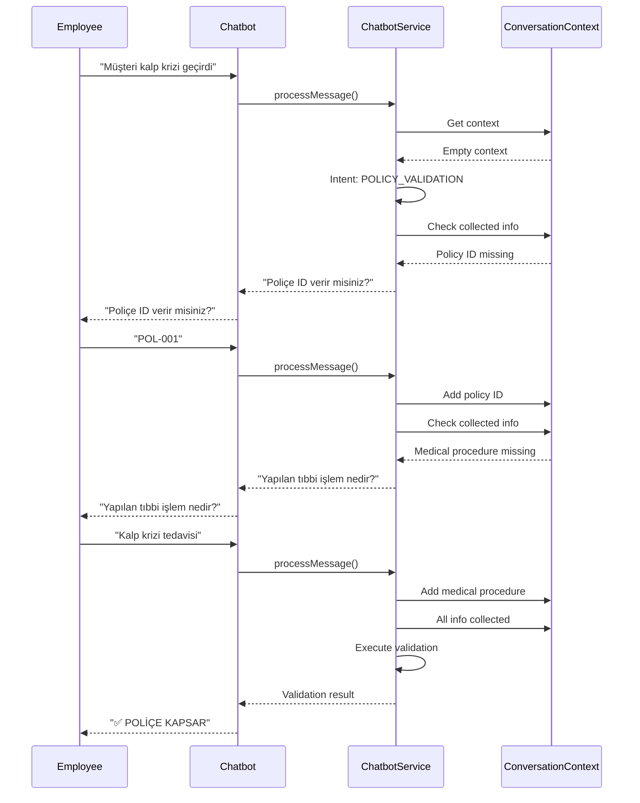

## 🔒 Security Layer

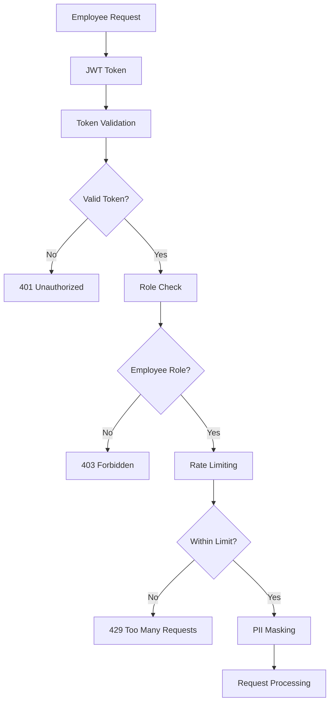

## 📊 Response Types

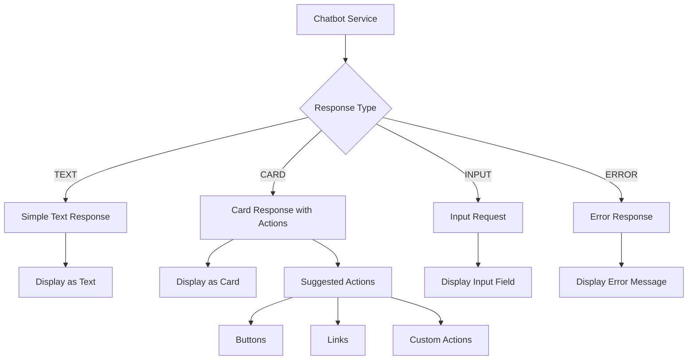

## 🎯 WebSocket vs REST API

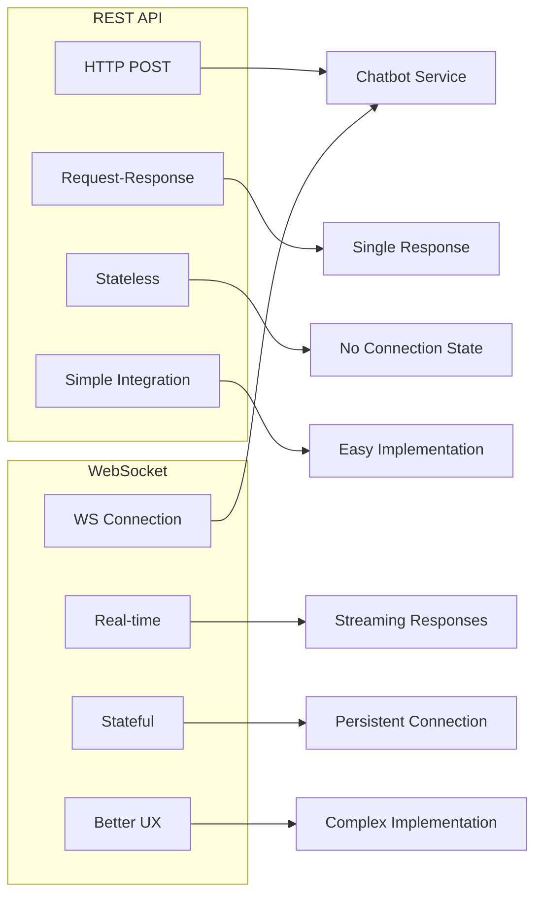

## 🎨 Frontend Architecture

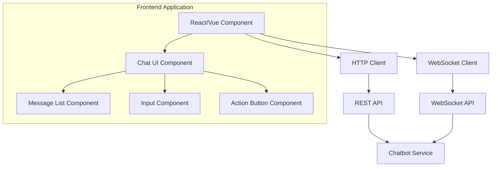

## 📊 Analytics Flow

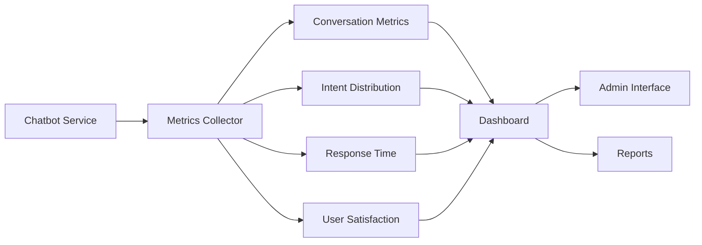

## 🔄 Error Handling Flow

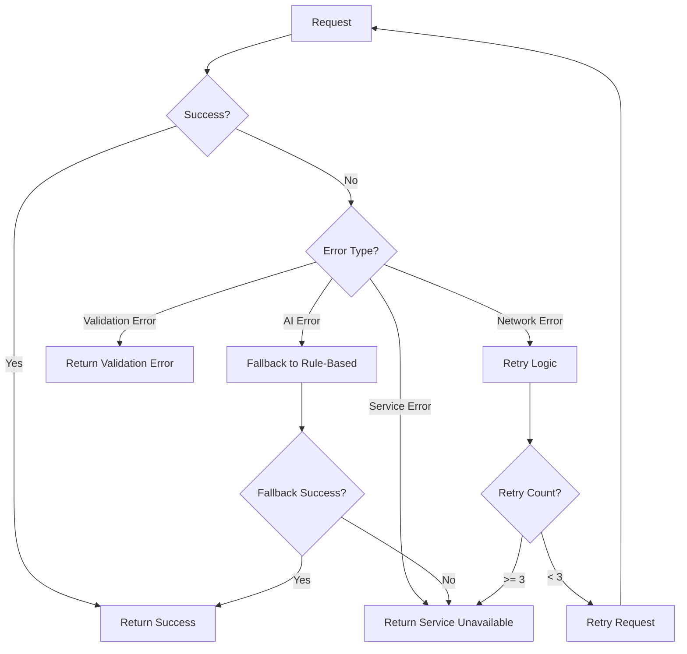

## 🎯 Multi-Channel Architecture

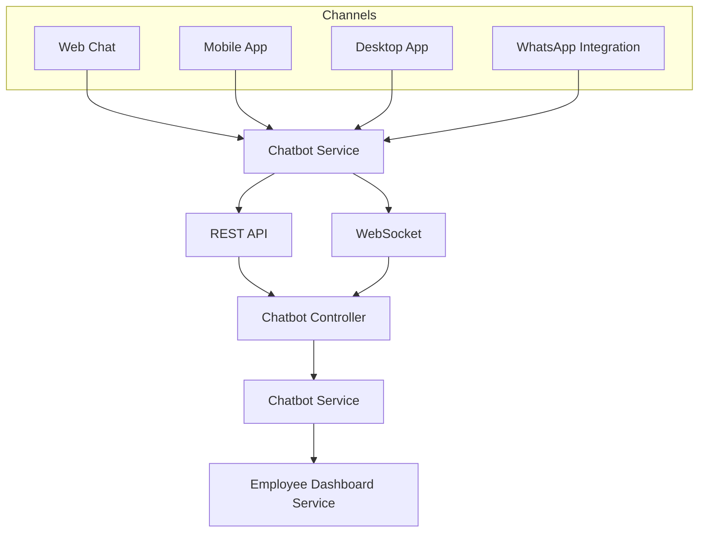