# 🎨 Employee Dashboard Architecture Diagrams

## 🎯 Overall System Architecture

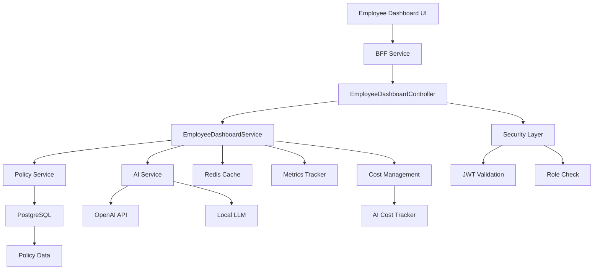

## 🔄 Policy Validation Flow

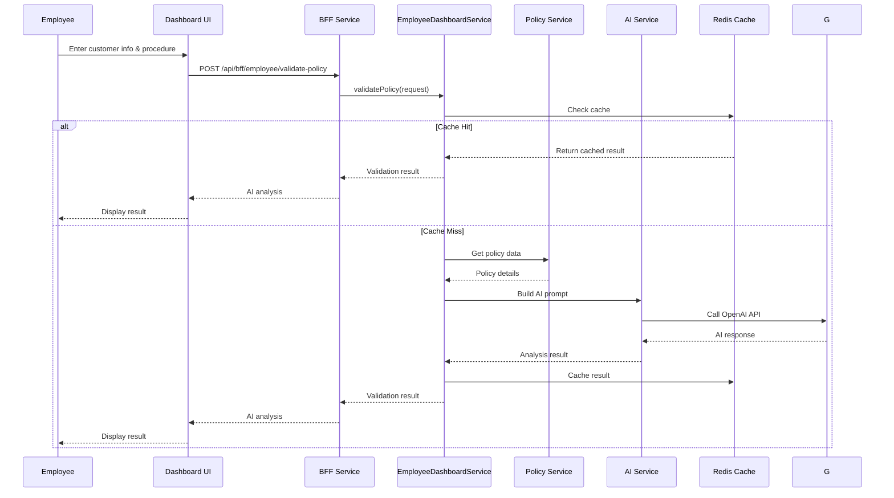

## 📄 Document Recommendation Flow

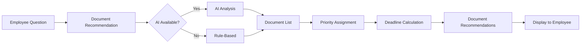

## 🎯 Dashboard UI Components

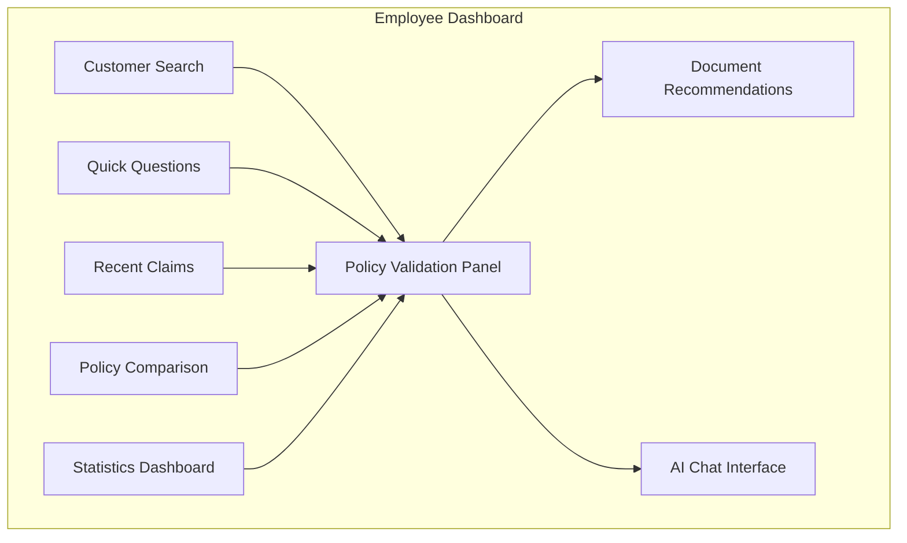

## 🔒 Security Layer

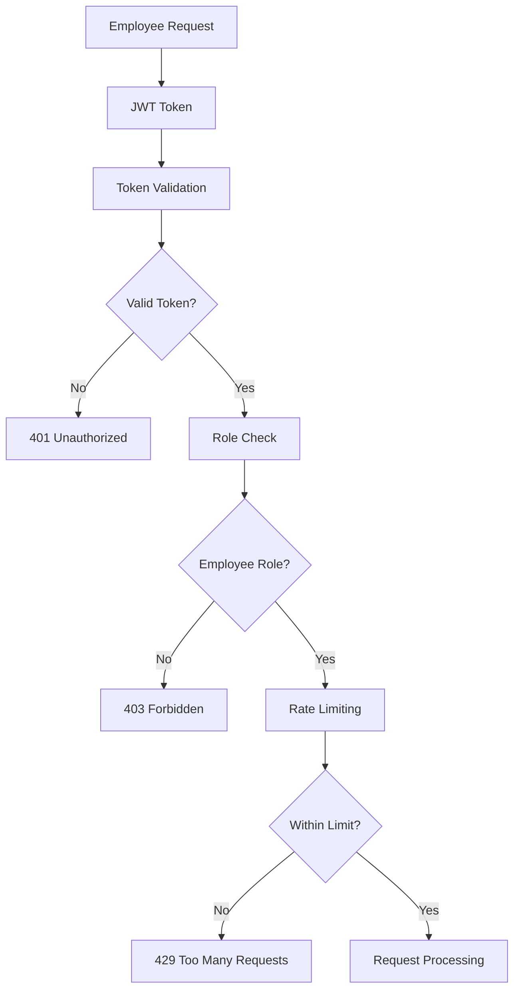

## 💰 Cost Management Flow

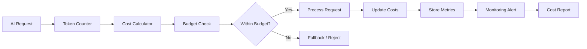

## 📊 AI vs Rule-Based Decision

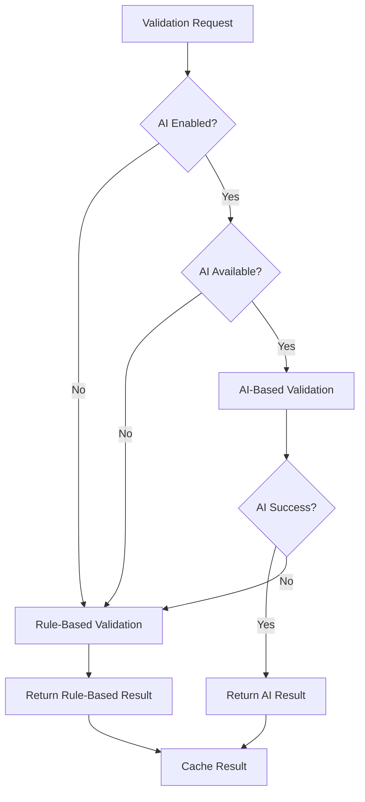

## 🎯 Use Case: Emergency Scenario

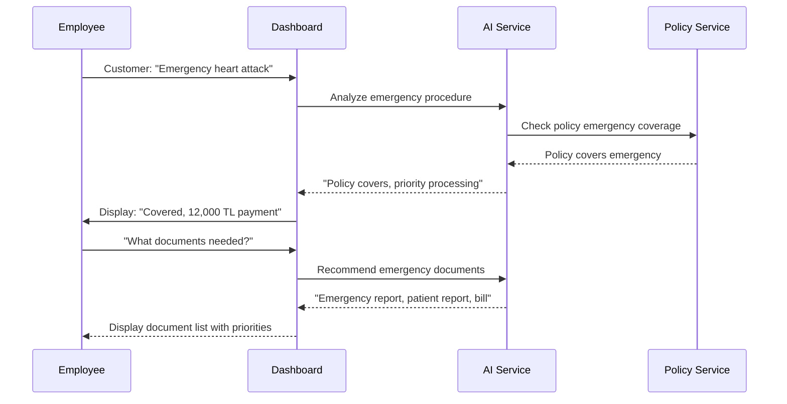

## 📱 Mobile vs Desktop UI

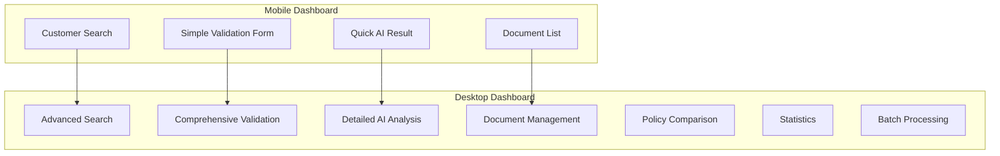

## 🔄 Data Flow: Complete Validasyon

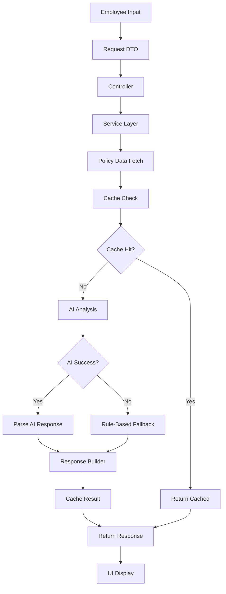

## 🎨 Component Hierarchy

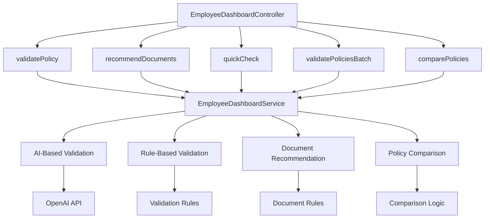

## 📊 Performance Optimization

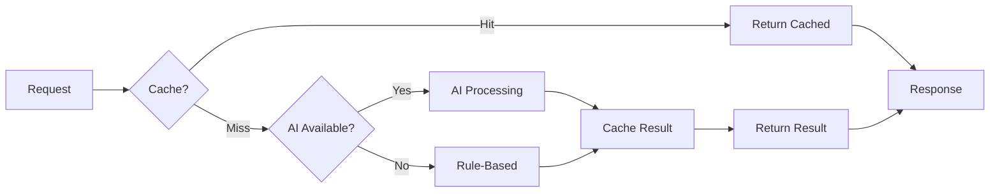

## 🎯 Error Handling Flow

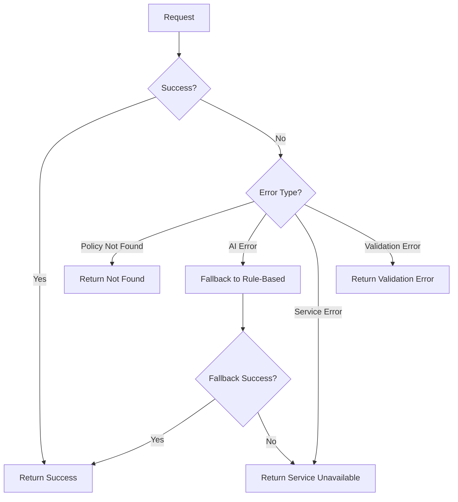