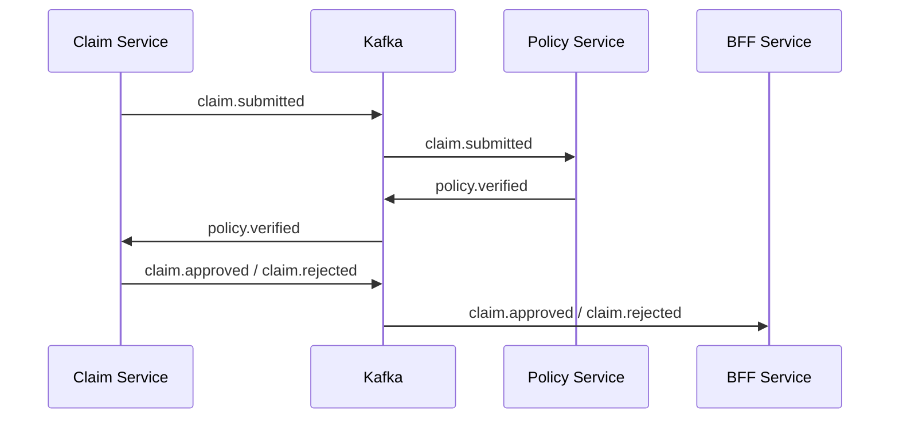
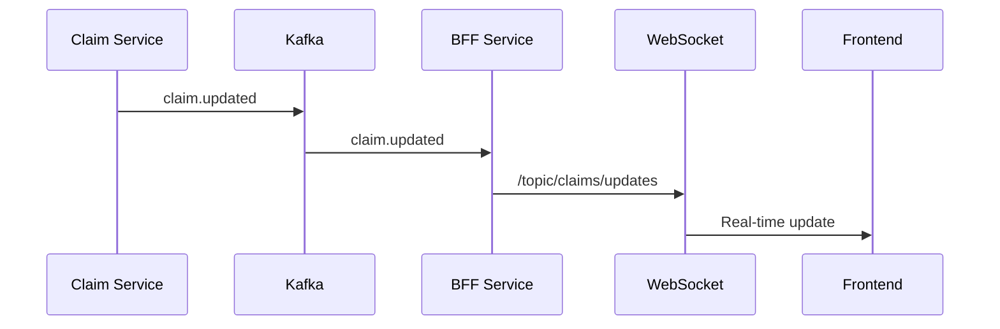
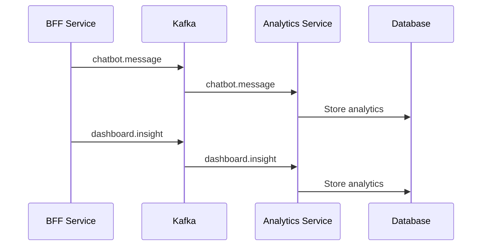

# 📡 Apache Kafka Entegrasyonu - Kapsamlı Dokümantasyon

## 🎯 Amaç

Bu projede Apache Kafka'nın kullanım alanlarını, konfigürasyonlarını ve best practices'lerini açıklar.

---

## 📋 Kafka Konfigürasyonları

### 1. **Claim Service Kafka Config**

**File:** `claim-service/src/main/java/com/sigorta/claim_service/config/KafkaConfig.java`

**Producer Konfigürasyonu:**
```java
config.put(ProducerConfig.BOOTSTRAP_SERVERS_CONFIG, "localhost:9092");
config.put(ProducerConfig.KEY_SERIALIZER_CLASS_CONFIG, StringSerializer.class);
config.put(ProducerConfig.VALUE_SERIALIZER_CLASS_CONFIG, JsonSerializer.class);
config.put(ProducerConfig.ACKS_CONFIG, "all");
config.put(ProducerConfig.RETRIES_CONFIG, 3);
config.put(ProducerConfig.LINGER_MS_CONFIG, 1000);
config.put(ProducerConfig.BATCH_SIZE_CONFIG, 16384);
config.put(ProducerConfig.BUFFER_MEMORY_CONFIG, 33554432);
config.put(ProducerConfig.COMPRESSION_TYPE_CONFIG, "snappy");
```

**Consumer Konfigürasyonu:**
```java
config.put(ConsumerConfig.BOOTSTRAP_SERVERS_CONFIG, "localhost:9092");
config.put(ConsumerConfig.GROUP_ID_CONFIG, "claim-service-group");
config.put(ConsumerConfig.KEY_DESERIALIZER_CLASS_CONFIG, StringDeserializer.class);
config.put(ConsumerConfig.VALUE_DESERIALIZER_CLASS_CONFIG, JsonDeserializer.class);
config.put(JsonDeserializer.TRUSTED_PACKAGES, "*");
config.put(ConsumerConfig.AUTO_OFFSET_RESET_CONFIG, "earliest");
```

**Advanced Features:**
- **Manual ACK:** `factory.getContainerProperties().setAckMode(ContainerProperties.AckMode.MANUAL)`
- **Concurrency:** `factory.setConcurrency(3)`

---

### 2. **Policy Service Kafka Config**

**File:** `policy-service/src/main/java/com/sigorta/policy_service/config/KafkaConfig.java`

**Producer Konfigürasyonu:**
```java
config.put(ProducerConfig.BOOTSTRAP_SERVERS_CONFIG, "localhost:9092");
config.put(ProducerConfig.KEY_SERIALIZER_CLASS_CONFIG, StringSerializer.class);
config.put(ProducerConfig.VALUE_SERIALIZER_CLASS_CONFIG, JsonSerializer.class);
```

**Consumer Konfigürasyonu:**
```java
config.put(ConsumerConfig.BOOTSTRAP_SERVERS_CONFIG, "localhost:9092");
config.put(ConsumerConfig.GROUP_ID_CONFIG, "policy-service-group");
config.put(ConsumerConfig.KEY_DESERIALIZER_CLASS_CONFIG, StringDeserializer.class);
config.put(ConsumerConfig.VALUE_DESERIALIZER_CLASS_CONFIG, JsonDeserializer.class);
config.put(JsonDeserializer.TRUSTED_PACKAGES, "*");
config.put(ConsumerConfig.AUTO_OFFSET_RESET_CONFIG, "earliest");
```

---

### 3. **BFF Service Kafka Config**

**File:** `bff-service/src/main/java/com/sigorta/bff_service/config/KafkaConfig.java`

**Producer Konfigürasyonu:**
```java
config.put(ProducerConfig.BOOTSTRAP_SERVERS_CONFIG, "localhost:9092");
config.put(ProducerConfig.KEY_SERIALIZER_CLASS_CONFIG, StringSerializer.class);
config.put(ProducerConfig.VALUE_SERIALIZER_CLASS_CONFIG, JsonSerializer.class);
config.put(ProducerConfig.ACKS_CONFIG, "all");
config.put(ProducerConfig.RETRIES_CONFIG, 3);
config.put(ProducerConfig.LINGER_MS_CONFIG, 1000);
config.put(ProducerConfig.BATCH_SIZE_CONFIG, 16384);
config.put(ProducerConfig.BUFFER_MEMORY_CONFIG, 33554432);
```

**Consumer Konfigürasyonu:**
```java
config.put(ConsumerConfig.BOOTSTRAP_SERVERS_CONFIG, "localhost:9092");
config.put(ConsumerConfig.GROUP_ID_CONFIG, "bff-service-group");
config.put(ConsumerConfig.KEY_DESERIALIZER_CLASS_CONFIG, StringDeserializer.class);
config.put(ConsumerConfig.VALUE_DESERIALIZER_CLASS_CONFIG, JsonDeserializer.class);
config.put(JsonDeserializer.TRUSTED_PACKAGES, "*");
config.put(ConsumerConfig.AUTO_OFFSET_RESET_CONFIG, "earliest");
config.put(ConsumerConfig.ENABLE_AUTO_COMMIT_CONFIG, false);
config.put(ConsumerConfig.MAX_POLL_RECORDS_CONFIG, 100);
config.put(ConsumerConfig.MAX_POLL_INTERVAL_MS_CONFIG, 300000);
```

**Advanced Features:**
- **Manual ACK:** Automatic commit disabled
- **Concurrency:** `factory.setConcurrency(3)`

---

## 📊 Kafka Topic'leri

### 1. **Saga Pattern Topic'leri**

| Topic | Producer | Consumer | Purpose |
|-------|----------|----------|---------|
| `claim.submitted` | Claim Service | Policy Service | Hasar gönderildi event'i |
| `policy.verified` | Policy Service | Claim Service | Poliçe doğrulama sonucu |
| `claim.approved` | Claim Service | BFF Service | Hasar onaylandı event'i |
| `claim.rejected` | Claim Service | BFF Service | Hasar reddedildi event'i |

### 2. **Real-time Update Topic'leri**

| Topic | Producer | Consumer | Purpose |
|-------|----------|----------|---------|
| `claim.updated` | Claim Service | BFF Service | Hasar güncellendi event'i |
| `policy.updated` | Policy Service | BFF Service | Poliçe güncellendi event'i |

### 3. **Analytics Topic'leri**

| Topic | Producer | Consumer | Purpose |
|-------|----------|----------|---------|
| `chatbot.message` | BFF Service | Analytics Service | Chatbot mesajları |
| `dashboard.insight` | BFF Service | Analytics Service | Dashboard analitikleri |

---

## 🔄 Event Flow'lar

### 1. **Saga Pattern Flow**



### 2. **Real-time Update Flow**



### 3. **Analytics Flow**



---

## 🎯 Event Objeleri

### 1. **ClaimUpdatedEvent**

**File:** `bff-service/src/main/java/com/sigorta/bff_service/events/ClaimUpdatedEvent.java`

```java
@Data
@Builder
public class ClaimUpdatedEvent {
    private UUID claimId;
    private String claimNumber;
    private String status;
    private BigDecimal approvedAmount;
    private BigDecimal customerPayment;
    private LocalDateTime updatedAt;
    private String correlationId;
}
```

### 2. **PolicyUpdatedEvent**

**File:** `bff-service/src/main/java/com/sigorta/bff_service/events/PolicyUpdatedEvent.java`

```java
@Data
@Builder
public class PolicyUpdatedEvent {
    private UUID policyId;
    private String policyNumber;
    private String status;
    private BigDecimal coverageLimit;
    private BigDecimal remainingCoverage;
    private LocalDate endDate;
    private String updatedBy;
    private String correlationId;
}
```

### 3. **ChatbotMessageEvent**

**File:** `bff-service/src/main/java/com/sigorta/bff_service/events/ChatbotMessageEvent.java`

```java
@Data
@Builder
public class ChatbotMessageEvent {
    private UUID conversationId;
    private String userId;
    private String message;
    private String intent;
    private String response;
    private LocalDateTime timestamp;
    private String correlationId;
    private Map<String, Object> metadata;
}
```

### 4. **DashboardInsightEvent**

**File:** `bff-service/src/main/java/com/sigorta/bff_service/events/DashboardInsightEvent.java`

```java
@Data
@Builder
public class DashboardInsightEvent {
    private UUID eventId;
    private String userId;
    private String actionType; // VALIDATION, RECOMMENDATION, QUICK_CHECK
    private String policyId;
    private String policyNumber;
    private String result; // COVERED, NOT_COVERED, PARTIALLY_COVERED
    private String analysisSource; // AI, RULE_BASED
    private LocalDateTime timestamp;
    private String correlationId;
}
```

---

## 🔌 Kafka Listener'lar

### 1. **BFF KafkaEventListener**

**File:** `bff-service/src/main/java/com/sigorta/bff_service/listener/KafkaEventListener.java`

**Topic'ler:**
- `claim.updated` - Hasar güncellemelerini dinler
- `policy.updated` - Poliçe güncellemelerini dinler

**Fonksiyonlar:**
- **Cache Invalidation:** Redis cache'i temizler
- **WebSocket Notification:** Frontend'e real-time update gönderir
- **Manual ACK:** Kafka acknowledgment yönetimi

```java
@KafkaListener(topics = "claim.updated", groupId = "bff-service-group")
public void handleClaimUpdated(ClaimUpdatedEvent event, Acknowledgment ack) {
    log.info("Received claim updated event: {}", event.getClaimNumber());
    
    try {
        invalidateClaimCache(event.getClaimId());
        sendClaimUpdateNotification(event);
        
        if (ack != null) {
            ack.acknowledge();
        }
    } catch (Exception e) {
        log.error("Error processing claim updated event", e);
        if (ack != null) {
            ack.nack();
        }
    }
}
```

---

## 🚀 Advanced Kafka Features

### 1. **Partitioning**

**Key-based Partitioning:**
```java
kafkaTemplate.send("claim.updated", claim.getClaimNumber(), event);
```

**Avantajları:**
- Aynı claim number'ları aynı partition'a gider
- Ordering guarantee
- Load balancing

### 2. **Consumer Groups**

**Consumer Group Configuration:**
```java
config.put(ConsumerConfig.GROUP_ID_CONFIG, "claim-service-group");
```

**Avantajları:**
- Load balancing
- Offset management
- Fault tolerance

### 3. **Manual ACK**

**Manual ACK Configuration:**
```java
factory.getContainerProperties().setAckMode(ContainerProperties.AckMode.MANUAL);
```

**Avantajları:**
- Kontrolü geliştiriciye verir
- Hata durumunda NACK
- At-least-once semantics

### 4. **Compression**

**Compression Configuration:**
```java
config.put(ProducerConfig.COMPRESSION_TYPE_CONFIG, "snappy");
```

**Avantajları:**
- Network bandwidth tasarrufu
- Daha düşük latency
- Storage optimization

### 5. **Batching**

**Batching Configuration:**
```java
config.put(ProducerConfig.BATCH_SIZE_CONFIG, 16384);
config.put(ProducerConfig.LINGER_MS_CONFIG, 1000);
```

**Avantajları:**
- Daha yüksek throughput
- Daha düşük CPU kullanımı
- Optimal network utilization

---

## 📡 Kafka vs REST API

| Özellik | Kafka | REST API |
|---------|-------|----------|
| Communication | Asynchronous | Synchronous |
| Latency | Lower | Higher |
| Throughput | Higher | Lower |
| Coupling | Loose | Tight |
| Scalability | Excellent | Good |
| Complexity | Higher | Lower |
| Real-time | Excellent | Good |
| Use Case | Event-driven | Request-response |

---

## 🎯 Kullanım Senaryoları

### 1. **Saga Pattern**
- Dağıtık transaction yönetimi
- Event-driven communication
- Compensation logic

### 2. **Real-time Updates**
- Frontend notification
- Cache invalidation
- Dashboard updates

### 3. **Analytics**
- User behavior tracking
- Performance metrics
- Audit trail

### 4. **Microservices Communication**
- Service decoupling
- Event sourcing
- Message queuing

---

## 🔒 Security Considerations

### 1. **SASL Authentication**
```java
config.put(CommonClientConfigs.SECURITY_PROTOCOL_CONFIG, "SASL_SSL");
config.put(SaslConfigs.SASL_MECHANISM, "PLAIN");
config.put(SaslConfigs.SASL_JAAS_CONFIG, "org.apache.kafka.common.security.plain.PlainLoginModule required username=\"user\" password=\"password\";");
```

### 2. **SSL Encryption**
```java
config.put(CommonClientConfigs.SECURITY_PROTOCOL_CONFIG, "SSL");
config.put(SslConfigs.SSL_TRUSTSTORE_LOCATION, "/path/to/truststore.jks");
config.put(SslConfigs.SSL_TRUSTSTORE_PASSWORD, "password");
```

### 3. **Data Encryption**
- Transit encryption (SSL/TLS)
- At-rest encryption (disk encryption)
- Application-level encryption (sensitive data)

---

## 📊 Monitoring

### 1. **Kafka Metrics**
- Producer metrics: `record-send-rate`, `record-error-rate`
- Consumer metrics: `records-consumed-rate`, `lag`
- Topic metrics: `messages-in-per-sec`, `bytes-in-per-sec`

### 2. **Spring Boot Actuator**
```yaml
management:
  endpoints:
    web:
      exposure:
        include: health,metrics,kafka
```

### 3. **JMX**
- Kafka JMX monitoring
- Consumer lag monitoring
- Producer throughput monitoring

---

## 🎓 Mülakat Soruları

### **Q: Neden Kafka kullanıyoruz?**
**A:**
- Asynchronous communication
- High throughput
- Loose coupling
- Event-driven architecture
- Real-time processing

### **Q: Saga pattern nasıl çalışır?**
**A:**
- Event-driven communication
- Compensation logic
- Kafka topic'leri
- Correlation ID tracking

### **Q: Consumer group nedir?**
**A:**
- Load balancing
- Offset management
- Fault tolerance
- Consumer instance coordination

### **Q: Manual ACK neden kullanılır?**
**A:**
- Kontrolü geliştiriciye verir
- Hata durumunda NACK
- At-least-once semantics
- Better error handling

---

## 🚀 Best Practices

1. **Use meaningful keys:** Partitioning için
2. **Set appropriate batch sizes:** Throughput için
3. **Enable compression:** Network tasarrufu için
4. **Use consumer groups:** Load balancing için
5. **Implement manual ACK:** Kontrol için
6. **Monitor consumer lag:** Performance için
7. **Use dead letter queues:** Hata yönetimi için
8. **Implement retry logic:** Fault tolerance için
9. **Use compression:** Storage tasarrufu için
10. **Set appropriate retention:** Disk yönetimi için

---

Bu dokümantasyon, projede Apache Kafka'nın kapsamlı kullanımını açıklar. Tüm konfigürasyonlar, topic'ler, event'ler ve best practices içerir.